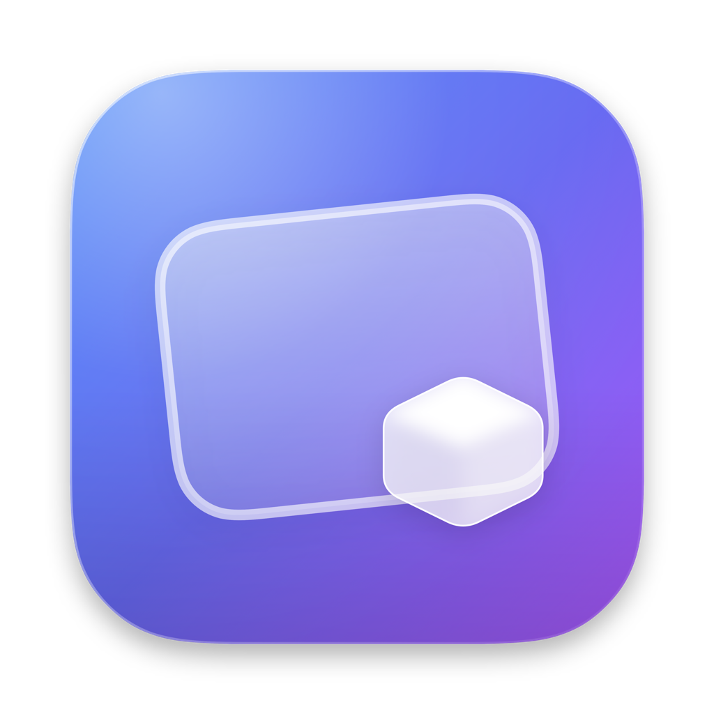

<div align="center">



# IceShot

**原生 macOS 截图工具 · 截取 → 标注 → 复制 / 保存 / 历史**

菜单栏常驻，用完即走 · 界面原生 · 材质交给 Liquid Glass


[**下载最新版**](https://github.com/aice109/ice-shot/releases/latest) ·
[更新日志](CHANGELOG.md) ·
[路线图](docs/roadmap.md)

</div>

一款原生、轻快的 macOS 截图工具：**截取 → 标注 → 复制 / 保存 / 历史**，全程本地处理。
界面使用系统原生控件，材质交给 **Liquid Glass（液态玻璃）**，遵循
[Apple Human Interface Guidelines（macOS）](https://developer.apple.com/design/human-interface-guidelines/macos)。

菜单栏常驻、默认不占 Dock，用完即走。

---

## 功能

**截取**

- **区域截图** —— 拖拽框选，实时尺寸，8× 像素网格放大镜；`⇧` 锁比例、`⌥` 中心缩放、
  方向键微调、Space 拖动、双击确认。
- **点窗口即截** —— 还没框选时，光标下的窗口自动高亮，点一下直接截它；按住拖拽仍是框选。
  浮动窗口、贴图、桌面、菜单栏都可选。
- **窗口截图** —— 独立入口，悬停高亮、自动去阴影、多显示器。
- **全屏截图** —— 当前显示器，或逐屏截取全部显示器。
- **延时截图** —— 3 / 5 / 10 秒倒计时，随时可取消。
- **重复上次区域** —— 一键复用上次选区，显示器变化时自动回退到框选。
- **滚动长截图** —— 框选后自己滚动内容，自动按重叠带拼接成一张长图（不用辅助功能权限）。

**标注**

框选松手即进编辑，玻璃操作条就在选区下方：

- 矩形、椭圆、直线、箭头、画笔、高亮、文字、马赛克、序号、聚光灯、放大镜
- 文字可加背景块（实底 / 半透），文字自动取对比色
- 马赛克含马赛克 / 模糊 / 噪点 / 纯色四种质感
- 聚光灯把区域外压暗，放大镜在框内显示该区域的放大内容
- 选中移动、撤销 / 重做、裁剪、旋转 / 翻转、复制、另存为 PNG
- 参数点工具才弹出，不占操作条；颜色是内置色板，可在设置里换成自己的 2–8 色

**结果**

- **贴图** —— 把结果贴成置顶浮动窗口，可拖动、等比缩放、调透明度、点击穿透，多张并存
- **取字** —— 直接在图上拖选文字复制；二维码 / 条码点一下即复制
- **文字识别** —— 保存后用系统 Vision 在本机 OCR，结果可查、可搜、可重新识别
- **历史库** —— 本机 SwiftData + 沙盒文件，缩略图、筛选、搜索、收藏、删除、拖出到 Finder；
  默认保留 30 天 / 500 张 / 2 GB（收藏豁免）

**系统集成**

- 全局快捷键：`⇧⌘X` 区域、`⇧⌘K` 窗口、`⇧⌘F` 全屏、`⇧⌘R` 重复上次区域、`⇧⌘L` 长截图，可自行录制
- 开机自启动
- 屏幕录制权限引导（一键申请 / 跳转系统设置 / 重启）

完整能力与后续计划见 [路线图](docs/roadmap.md)，版本变更见 [CHANGELOG](CHANGELOG.md)。

---

## 系统要求

| 项目 | 版本 |
| --- | --- |
| 运行系统 | macOS **15.0** 及以上 |
| 芯片 | Apple Silicon（Intel 未验证） |
| 构建工具 | Xcode **27+** |

---

## 安装

> 发布包由维护者用 **Apple Development** 证书签名，**未经 Apple 公证**，首次打开需要手动放行一次。

从 [Releases](https://github.com/aice109/ice-shot/releases/latest) 下载最新的
`IceShot-<版本号>-beta.dmg`，然后：

1. 打开 DMG，把 **IceShot** 拖进「应用程序」。
2. 双击 IceShot，弹出「无法打开，因为 Apple 无法验证」时点「完成」。
3. 打开 **系统设置 → 隐私与安全性**，滚到底部点「**仍要打开**」，输入密码。
4. 启动后 IceShot 会引导申请**屏幕录制权限**：点「请求屏幕录制权限」，在
   **系统设置 → 隐私与安全性 → 录屏与系统录音** 里打开 IceShot 的开关，
   回到 IceShot 点「立即重启 IceShot」。

> macOS 15 起「右键 → 打开」的旧绕过方式已被移除，必须走第 3 步。
> 若提示「已损坏，应移到废纸篓」，执行
> `xattr -dr com.apple.quarantine /Applications/IceShot.app` 后重试；更稳妥的方式是自行编译。

### 屏幕录制授权后仍提示无权限？

权限在**下次启动**才生效。确认系统设置里的开关已打开，然后点 IceShot 里的「立即重启 IceShot」。
如果之前用过其他签名的构建，可能有残留记录：

```bash
tccutil reset ScreenCapture com.aice109.IceShot
```

再重新授权并重启 App。

---

## 从源码构建

```bash
# 1. 配置自己的签名团队（只需一次）
cp Signing.local.xcconfig.example Signing.local.xcconfig
# 编辑 Signing.local.xcconfig，填入你的 DEVELOPMENT_TEAM

# 2. 用 Xcode 打开工程
open IceShot.xcodeproj
```

命令行构建：

```bash
xcodebuild -project IceShot.xcodeproj \
  -scheme IceShot \
  -configuration Debug \
  -destination 'platform=macOS' \
  build
```

在 Xcode 中按 <kbd>⌘</kbd><kbd>R</kbd> 运行。

> `Signing.local.xcconfig` 已在 `.gitignore` 里——你的 Team ID 不会进版本库。
> 没配置也能编译，只是无法签名分发。
>
> 工程使用 **文件系统同步分组**：新增 Swift 文件直接放进 `IceShot/` 即可自动纳入编译，
> 不需要手工编辑 `project.pbxproj`。

### 打包 DMG

```bash
Scripts/package.sh                      # → IceShot-<版本号>.dmg + .sha256
ICESHOT_CHANNEL=beta Scripts/package.sh # 预览版 → IceShot-<版本号>-beta.dmg
```

产物写在仓库根目录，已被忽略，不提交。打包前会先跑构建 + 单测门禁。

---

## 隐私

- **只在用户主动触发时截取**，没有后台连续截屏。
- **完全不联网** —— 应用不申请网络权限（沙盒 entitlements 里没有 `com.apple.security.network.client`），
  没有任何联网代码：没有更新检查、没有遥测、没有崩溃上报。新版本请自行到
  [发布页](https://github.com/aice109/ice-shot/releases) 下载。
  OCR 与取字全部使用系统本机能力。
- 截图默认只存在本机沙盒容器或你选择的位置。
- 截图内容、文件路径、窗口标题**不写入日志**。
- 权限最小化：只用屏幕录制；长截图不申请辅助功能或输入监控。

---

## 许可

[MIT](LICENSE)
