# 光标形态总表

IceShot 里**所有会出现的光标**，一张表看完。改任何光标行为前先读这里，
代码改动必须同步更新本文件（表里每一行都有对应的单一判定来源）。

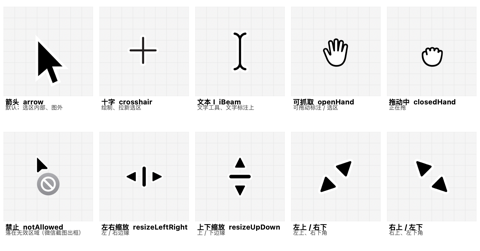

---

## 一、设计原则

1. **光标是「这里现在能做什么」的唯一交代。** 不能做任何事的地方，就该是箭头；
   能缩放就该是那个方向的缩放箭头；落在无效区域就该明确说「不行」。
2. **不允许散写 `NSCursor.xxx.set()`。** 视图只声明「此刻应该是什么」
   （`.pointerCursor(_:)`），映射统一走 `Core/Interaction/PointerCursor.swift`。
   push / pop 只用于拖拽期间的临时覆盖，且必须成对（`PointerCursorStack`）。
3. **判定要能算出来，不能靠事件记。** 指针不动时 hover 不会回调，
   所以「应该是什么」必须由「指针位置 + 选区 + 按键状态」这组输入推导，
   而不是依赖某次事件顺手把光标改回去。

---

## 二、全部光标形态

下表是**代码里存在的每一种光标**。「语义」是 `PointerCursor` 的 case，
「系统光标」是它实际映射到的 `NSCursor`。

| 图 | 语义（代码） | 系统光标 | 用在哪 |
| --- | --- | --- | --- |
| 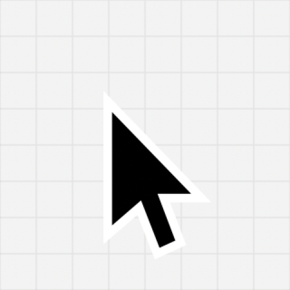 | `.arrow` | `NSCursor.arrow` | 默认态；选区内部（框选完成后）；图外 |
| 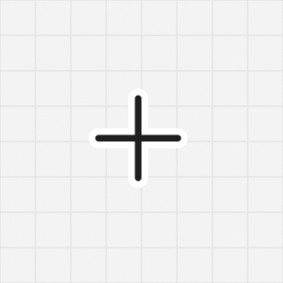 | `.crosshair` | `NSCursor.crosshair` | 还没框选时拉新选区；绘制类工具的图上空白 |
| 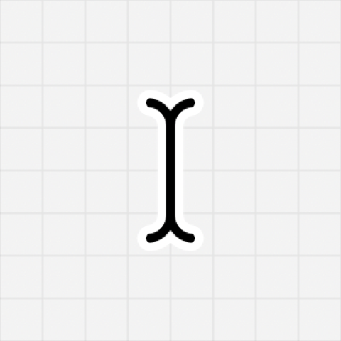 | `.iBeam` | `NSCursor.iBeam` | 文字工具在图上；文字工具悬停在已有文字上 |
| 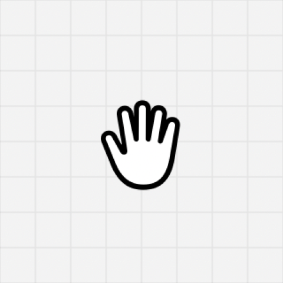 | `.openHand` | `NSCursor.openHand` | 悬停在已有标注上；选区 + 按住 Space |
| 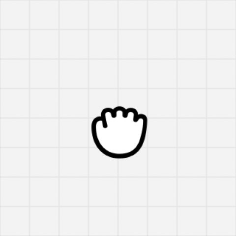 | `.closedHand` | `NSCursor.closedHand` | 正在拖动标注 / 选区 / 裁剪框 |
| 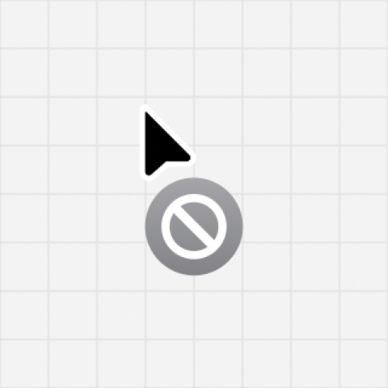 | `.notAllowed` | `NSCursor.operationNotAllowed` | **落在无效区域**：框选后指针在选区外（见第五节） |

`PointerCursor.move` 是 `.openHand` 的别名语义（「可整块搬走」），
AppKit 没有公开的四向移动箭头，手形才是系统里的「可抓取」语义。

### 缩放方向 → 系统光标（8 个方向 → 4 个光标）

macOS 的缩放箭头**本质是双向的**，所以 8 个方向只有 4 种光标。
这不是缺陷，是系统给窗口边缘用的那套。

| 图 | 语义 | 系统光标 | 手柄位置 |
| --- | --- | --- | --- |
| 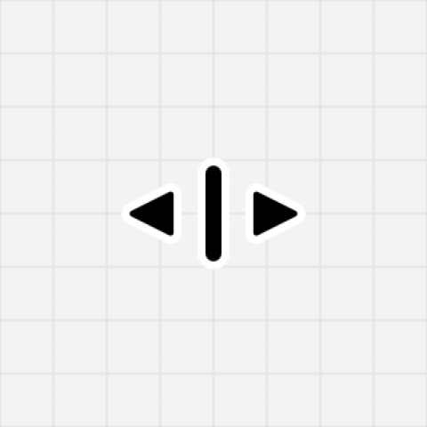 | `.resizing(.leading)` / `.resizing(.trailing)` | `NSCursor.resizeLeftRight` | 左中、右中 |
| 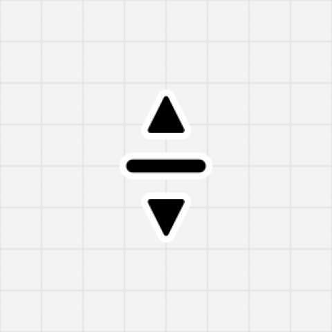 | `.resizing(.top)` / `.resizing(.bottom)` | `NSCursor.resizeUpDown` | 上中、下中 |
| 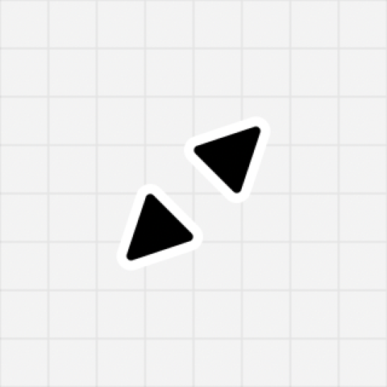 | `.resizing(.topLeading)` / `.resizing(.bottomTrailing)` | `frameResize(position: .topLeft)` | 左上角、右下角 |
| 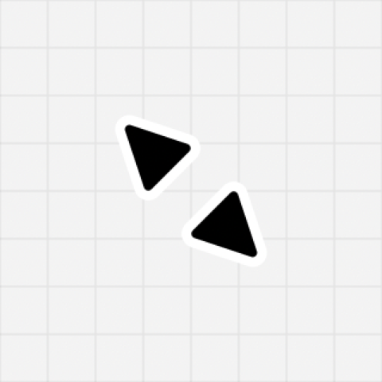 | `.resizing(.topTrailing)` / `.resizing(.bottomLeading)` | `frameResize(position: .topRight)` | 右上角、左下角 |

> 对照：上边和下边都是 ↕，左上和右下是同一条斜向箭头——这是 macOS 原生行为，
> 微信、系统截图、Finder 窗口缩放全都一样。

---

## 三、浮层选区阶段（框选时）

判定来源：`Core/Interaction/SelectionCursorRule.swift`（纯函数，有单测）。

| 位置 | 光标 | 图 |
| --- | --- | --- |
| 还没框选 · 整屏 | 十字 |  |
| 还没框选 · 悬停到窗口 | 十字（同时高亮该窗口） |  |
| 正在拉框（按下未松手） | 十字（拖到选区外也照旧） |  |
| 框选完成 · 选区内部 | **箭头** |  |
| 框选完成 · 贴着选区四周约 4 pt | 该方向的缩放箭头 |  |
| **框选完成 · 选区内 + 按住 Space** | **抓手 → 拖动中变抓紧** |  |
| **框选完成 · 选区外** | **禁止** |  |
| 指针移出屏幕 | 箭头 |  |
| **选中标注工具后 · 选区内空白** | **十字**（文本 = 文本 I，选择态 = 箭头） |  |
| 预设选区（窗口 / 全屏 / 重复区域） | 交给标注画布 | — |

四条硬约定：

- **框选完成后选区内部是箭头**（编辑态则看工具）。那里没有任何动作，
  十字会让人以为还能继续画框。整块能拖是**按住 Space** 之后的事，那时才变抓手。
- **选区外是禁止**。框已经定了，此时在选区外按下不会产生任何结果，
  用系统的「不可操作」光标把这件事说清楚（对齐微信截图）。
- **拉框时不报禁止**。正在拖的时候指针本来就会跑在选区之外，那是本意，不是无效操作。
- **四边四角始终提示缩放，与工具无关**。边缘手柄带是「调选区大小」的专用地带，
  工具亮着时也不让位——否则同一格窄带里内侧是十字、外侧是缩放，光标来回跳。
  这条与「选区外始终禁止」一样，任何工具下都不变。

### 按住 Space：拖移整个选区

| 状态 | 光标 | 提示 |
| --- | --- | --- |
| 未按 Space · 选区内 | 箭头（工具态则十字 / 文本 I） | 无 |
| **按住 Space · 选区内** | **抓手** | 「按住 Space 可拖动选区 · 松开结束」 |
| 按住 Space · 拖动中 | 抓紧 | 同上 |
| 松开 Space | 立刻回到对应状态 | 立刻消失 |
| 按住 Space · 选区外 | 禁止 | 无（拖不了） |

Space 是「拖移整个截图范围」的唯一入口，所以它**优先级高于工具态**：
按住时即使画着矩形，抓手也要出来。提示与光标同时出现、同时消失——
只变光标不够，用户不知道松手就结束。

---

## 四、标注画布（编辑态）

判定来源：`Core/Interaction/SelectionCursorRule.swift`（纯函数，有单测）。
**只有这一处算光标**，指针在哪一格就按那一格的规则。

### 区域与优先级

逐条查表，**第一条命中就停**。顺序本身就是规则的一部分，别调换：

| 顺序 | 区域 | 光标 |
| --- | --- | --- |
| 1 | 手势中（拖标注 / 拖选区 / 拉新框） | 锁死：抓紧 / 抓手 / 十字，不随区域变 |
| 2 | 操作条（含其弹出的浮窗） | 正常箭头 |
| 3 | 边框（四边含四角，内外侧 ±4 pt） | 该方向缩放（角优先于边） |
| 4 | 暗区（选区外） | 禁止 |
| 5 | 绘制区域（标注实际画到的范围） | 抓手；按住 → 抓紧；松手仍在 → 抓手 |
| 6 | 截图区域 | 选择态箭头 · 文本 / 取字 I · 其余工具十字 |

三条容易做错的地方：

- **操作条必须排在最前。** 它压在暗区上、有时还挡着边框。若按区域先后判，
  指针经过操作条会被判成「禁止」或「缩放」——它是界面控件，永远正常箭头。
  弹窗是独立系统窗口，指针移到它上面时本面板收不到鼠标事件、位置会停在操作条那一格，
  所以这条一并覆盖了弹窗。

  **操作条的矩形要按浮层坐标系实测，不能拿「中心点 + size」反推。**
  用量出来的 `toolbarFrame` 判定；反推式一旦 size 量歪（首帧 `.zero`、`ViewThatFits`
  两行回退、窄屏夹紧）就会得到一块过大的矩形，把整片区域都判成操作条——
  表现是四个边全部失去缩放。同理不要用 `onHover` 记布尔：它离开时的回调不可靠，
  卡在 `true` 是同一个病。

  这个矩形必须包含两个胶囊之间那 10 pt 的**透明间隙**。指针穿过那条缝时视觉上仍在界面上，
  但两个胶囊的 `contentShape` 都不含它，只按胶囊判定就会漏掉。

  矩形由「`toolbarPosition` 算出的中心 + 实测尺寸」拼出——中心点与 `.position(...)`
  是**同一个函数**，不会各说各话。不要用 `frame(in: .named(...))`：命名坐标空间
  没解析出来时它会静默返回 `.zero`，判定于是全 false，表现是
  「工具条上穿过去仍是缩放、移出去才恢复」。尺寸用 `GeometryReader` 相对测量。

  **操作条与选区之间必须留出固定间隙**（`toolbarGap`，当前 14 pt），且要
  **大于 `edgeTolerance`（4 pt）**、也要留得出手柄的位置（10 pt 圆）。
  用固定数值当「中心偏移」而不减工具栏自身高度，工具条上边缘会顶到选区下边框：
  手柄被盖住拖不动。

- **光标提示的范围 = 能拖的范围。**
  边带上一整圈都显示缩放箭头，那四条边就**整条**都要能拖。以前只有 8 个 10 pt
  圆点能拖，光标却在一整圈上承诺「可以拉」——真机手感就是「只有几个点能拉，还不灵敏」。
  现在 `ResizeHandleHitArea` 用与光标判定**同一组常量**（`edgeTolerance` / `edgeBand`）
  铺命中矩形：四条边各一个整边长的透明条，四角各一个方块，角后声明盖在边上（角优先）。

- **边带按「带宽」给值，不是半宽。**
  `ResizeHitZone` 内部算的是 `edgeWidth / 2`。曾经把 `edgeTolerance`（4）
  同时当 `radius` 和 `edgeWidth` 传进去，边带实际只有 **2 pt**——
  指针几乎不可能精准停在 2 pt 内，真机上表现为「四个角能拉、四条边拉不动」。
  角半径与边带宽现在是两个独立常量（`edgeTolerance = 6` / `edgeBand = 12`）。

- **边框必须早于暗区。** `CGRect.contains` 是**半开**的，`maxX` / `maxY` 那条线上
  的点会被判成「在选区外」。先判暗区就把整条右边、下边和四个角的缩放吃掉了。
  用 `containsInclusive` / 直接先判 `axis(...)`。

- **「绘制区域」= 实际画到的地方。** 矩形、椭圆只算描边，中间空白不算；
  文字、序号、聚光灯亮区、放大镜框内整块都算。实现在 `EditorAnnotation.hitTest`，
  测试在 `AnnotationHitTestTests`。

### 光标只有一个算家

浮层外层（`SelectionOverlayView`）**永远**声明一次 `.pointerCursor(...)`；
`MarkupCanvas` 通过 `managesCursor: false` 关掉自己的光标逻辑，只负责画笔刷圆圈，
并把「正在拖动标注」经 `onMovingAnnotationChange` 上报——那个状态只有它知道。

编辑器窗口里没有这层外层，画布 `managesCursor` 取默认 `true`，用
`MarkupCursorRule` 自己算（那张表见下一节）。

**这是本文件里最不能让步的一条。** 以前两层各写一套全局 `NSCursor.set()`，
靠「谁后执行谁赢」拼结果，两边永远对不齐，光标 bug 反复出现。
修饰器也不许「兜底表态」（`.pointerCursor(x ? y : .arrow)` 这种）：
`ResizeHandleView` 曾这么写，8 个手柄常驻、每个都会 `apply(.arrow)`，盖掉所有人。
有话说才表态，没话说传 `nil`。

### 四条容易搞错的前提

- **命中区 =「实际会被改到的范围」，不是外接矩形。**
  矩形和椭圆是**描边不填充**的，所以只有四条边 / 椭圆周长算命中，
  框中间的空白**不显示抓手**。整框命中会让光标在空白处撒谎：显示能抓，按下却什么都没抓到。
  实心的类型（文字、序号徽章、聚光灯的亮区、放大镜框内）整块都算命中。
  实现在 `EditorAnnotation.hitTest`，测试在 `AnnotationHitTestTests`。

- **边缘手柄带的优先级高于当前工具。**
  那一圈窄带是「调选区大小」的专用地带，与「用什么工具画」无关：
  绘制工具亮着时贴边也照样给缩放箭头。否则同一格窄带里内侧是十字、外侧是缩放，
  光标会来回跳。要画东西往中间走几 pt 即可。

  判定在 `SelectionCursorRule` 里**先于**工具分支，且 `SelectionOverlayView.declaresCursor`
  用同一个 `axis(...)` 判定切分「谁管这一格」：贴边（含内侧）归外层，其余内部归画布。
  两边必须用同一个函数算，否则会出现「归画布管、但画布给不出缩放」的空档。

- **两边都用声明式光标，不许命令式 `set()`。**
  浮层外层用 `.pointerCursorIfPresent(...)`，画布用 `.pointerCursor(cursor)`。
  以前两边各自 `NSCursor.set()`，谁后执行谁赢：外层每帧都写缩放箭头，
  画布算对了也被盖掉，表现是「从边缘移进内部光标不变、点一下才对」。
  命令式 `set()` 只留给拖拽期的 `PointerCursorStack`（push / pop 成对）。

- **光标只有一处算家：`SelectionCursorRule`。**
  这是这条规则里唯一不能让步的一条。以前浮层外层按 `declaresCursor` 把选区内外
  分给两层各自 `NSCursor.set()`，靠「谁后执行谁赢」拼结果——两边永远对不齐：
  外层每帧写缩放盖掉画布的十字，手柄又拿 `.arrow` 兜底盖掉所有人。
  真机上一连串光标 bug（内部不变、底部不变、工具条旁随机缩放、选区外冒十字）
  都是这个分治造成的。

  现在浮层外层**永远**声明光标，规则纯函数地覆盖全部情况：
  手势态（拖标注 / Space 拖选区）→ 悬停标注 → 四边四角 → 内部按工具 → 选区外禁止。
  `MarkupCanvas` **完全不碰光标**，只负责画笔刷圆圈；它把「正在拖动标注」通过
  `onMovingAnnotationChange` 上报，因为那个状态只有它知道。

- **光标修饰器不许「兜底表态」。**
  `ResizeHandleView` 曾写 `.pointerCursor(isHovering ? .resizing(...) : .arrow)`，
  8 个手柄常驻、每个都会 `apply(.arrow)`。用 `.pointerCursorIfPresent(... : nil)`：
  **只在真有话要说时表态**。

- **「悬停已有标注」优先级高于「当前工具」。**
  画着矩形时也能直接拖走旧标注，不需要先按 `V`。
  代价是**不能在已有标注上起笔画新东西**，得从旁边空白起手。

- **刚画完的那条不算「悬停已有标注」。**
  笔尖一松，新图形就在指针正下方；若直接走命中规则，光标会立刻从十字跳成抓手，
  看起来像「画完就变成手、要点一下才回来」。
  `MarkupCanvas.justDrawnID` 屏蔽它，直到指针真正离开再移回来。

### 边缘热区

| 参数 | 值 | 说明 |
| --- | --- | --- |
| 四角命中半径 | 14 pt | 比边宽，避免斜向光标在角上一闪一闪 |
| 四边命中带宽 | 8 pt | 贴着边才换缩放箭头，整块内部不受影响 |

判定复用 `Core/Interaction/ResizeHitZone`（与截图选区手柄同一套），**角优先于边**。

热区**跨在图幅边界上**，所以边缘判定必须在「图外」判定之前算——
否则只剩外侧半边能变缩放箭头，里侧永远不行，手感像「半边死」。

---

## 五、「禁止」光标：落在无效区域


`NSCursor.operationNotAllowed`（箭头 + 🚫）。系统里表达「这里不能放 / 不能做」的
标准光标，拖放不可用时用的就是它；微信截图的框外也是它。

**用它的判据**：指针在某个**交互层的有效区域之外**，而那一层此刻正在接收鼠标事件。
只要指针根本没落在可交互层上（比如浮层整个不存在），就该是普通箭头，不是禁止。

**IceShot 的用法**：

| 位置 | 光标 |
| --- | --- |
| 框选完成 · 指针在选区外（未按 Space、不在拉框） | 禁止 |
| 标注画布 · 指针在选区外（编辑态） | 禁止 |

例外：**正在拉框时**拖到选区外不算无效——指针跑在选区之外本来就是拉框的正常形态，
所以那期间一直是十字。

---

## 六、坐标与实时性：两个必须守住的前提

光标判定依赖「指针现在在哪」，这里有两处曾经出错的地方，改动时不要退回旧写法。

### 1. 坐标只能有一个换算来源

`Core/Interaction/OverlayCoordinates.swift` 是屏幕坐标 ↔ 浮层视图坐标的**唯一**换算，
由 `OverlayCoordinatesTests` 锁住。三处都调它：浮层首帧播种、
`SelectionOverlayView.initialCursorPosition`、面板鼠标监视器。

历史上这三处各写一遍且写法不一致（监视器用 `contentView.bounds.height` 翻转 y，
另外两处用 `appKitFrame.maxY - mouse.y`）。两者一旦不等，y 就整体偏移一截，
真机表现是「指针明明在选区里，顶部一点却判成选区外 → 显示禁止光标」。

另外：**不能用 `CGRect.contains` 判「指针在不在屏幕上」**。它是半开区间
（含 `minX/minY`、不含 `maxX/maxY`），屏幕最上一行 / 最右一列会永远判成「不在屏幕上」。
统一用 `OverlayCoordinates.containsInclusive`。

### 2. 指针位置不能只靠 SwiftUI 的 hover

`onContinuousHover` 的追踪区跟着**具体子视图**走：指针停在手柄 / 工具条 / 画布上，
或停在两层之间的空隙里，父层就收不到事件，光标卡住不动——表现为「不实时变化，
点一下才变」。

所以浮层用窗口级事件监视器（`CaptureOverlayPanel.startPointerTracking()`）上报指针位置，
写进 `SelectionOverlayState.pointerByDisplay`，视图直接观察它重算。
hover 只作为拖拽中 / 首帧的补位。

---

## 七、改动流程

新增 / 修改一个光标格子时，四处必须同时改，缺一处就会不一致：

1. **语义** —— `Core/Interaction/PointerCursor.swift` 的 `case` 与 `system` 映射。
2. **判定** —— `SelectionCursorRule`（选区阶段）或 `MarkupCursorRule`（画布），
   只在纯函数里算，不在视图里写 if/else。
3. **测试** —— `IceShotTests/SelectionCursorRuleTests.swift`、
   `IceShotTests/MarkupCursorRuleTests.swift` 逐格锁住；
   坐标换算改动跑 `OverlayCoordinatesTests`。
4. **本文档** —— 上面第三节 / 第四节的表格。

再跑 `Scripts/gate.sh` 确认零警告、全测试通过。

---

## 附：本文档的图片怎么来的

`docs/images/cursors/*.png` 取自 macOS 自带的系统光标资源：

```
/System/Library/Frameworks/ApplicationServices.framework/.../HIServices.framework/.../Resources/cursors/<name>/cursor.pdf
```

用 CoreGraphics 渲染成 160×160、加 20 pt 浅灰网格底衬（方便看方向和大小）。
`arrow.png` 例外：系统不提供默认箭头的矢量资源（`NSCursor.arrow.image` 为空），
按系统箭头几何重绘。

`docs/images/cursor-overview.png` 是这些切片的合成总览图。
更新任何一张切片后，记得重新合成总览图。
